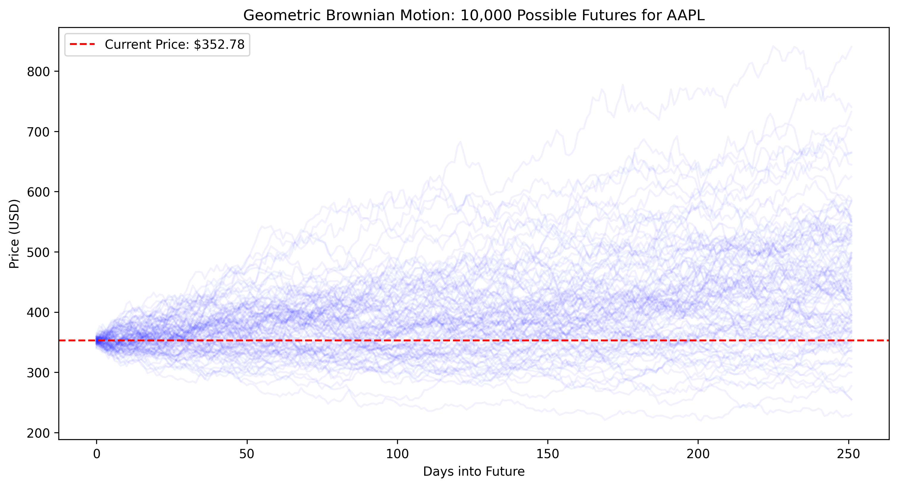

# Quantitative Finance & Equity Analysis Toolkit

A collection of Python models for derivative pricing, stochastic stock forecasting, and fundamental balance sheet extraction.

## Included Scripts
* **`black_scholes.py`**: Analytical Black-Scholes pricing model for European call options.
* **`monteandblackscholes.py`**: Vectorized Monte Carlo option pricing simulation demonstrating convergence to Black-Scholes as simulations scale to 1,000,000 paths.
* **`gbm_stock_forecast.py`**: Simulates 10,000 1-year equity price trajectories using Geometric Brownian Motion (GBM) and historical log returns via Yahoo Finance.
* **`balance_sheet_analyzer.py`**: Fetches real-time corporate balance sheet metrics (Total Debt, Cash, Total Assets) using `yfinance`.

## Sample Output


## How to Run
1. Clone the repository:
   ```bash
   git clone https://github.com
   cd finance_python
2. Install required libraries:
   ```bash
   pip install -r requirements.txt
   ```
3. Run any script:
   ```bash
   python gbm_stock_forecast.py
   ```

